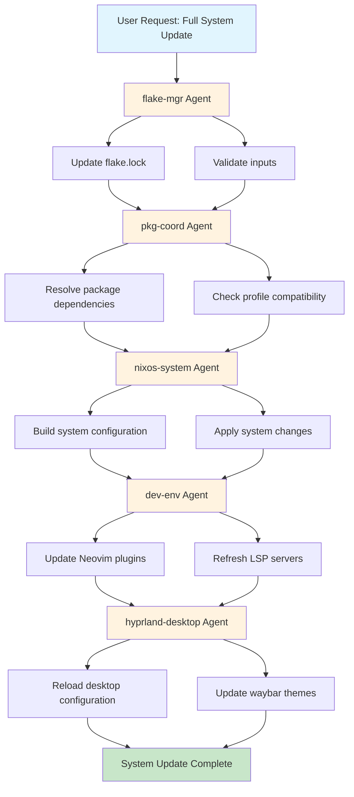
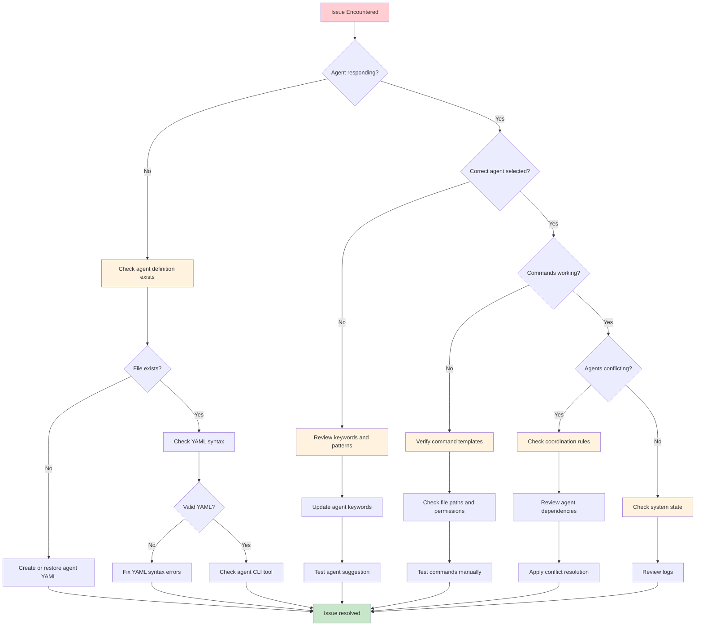

# NixOS Configuration Agents for Claude Code

This directory contains specialized sub-agent definitions designed to work with Claude Code (claude.ai/code) for managing and maintaining this NixOS configuration repository.

## Overview

These agents provide domain-specific expertise for different aspects of the NixOS configuration, enabling parallel processing, better context preservation, and more efficient updates to the system.

## Available Agents

### 1. **nixos-system** - System Configuration Specialist

- **Domain**: System-level NixOS configurations
- **Expertise**: Boot, kernel, networking, services, users
- **Key Files**: `nixos/core/`, hardware configurations
- **Use Cases**: System updates, service management, kernel configuration

### 2. **hyprland-desktop** - Desktop Environment Specialist

- **Domain**: Hyprland window manager and desktop environment
- **Expertise**: Wayland, waybar, keybindings, theming
- **Key Files**: `home/desktop/hyprland/`, waybar configs
- **Use Cases**: Desktop customization, window management, theme updates

### 3. **dev-env** - Development Environment Specialist

- **Domain**: Development tools and workflows
- **Expertise**: Neovim, tmux, shells, git, LSP servers
- **Key Files**: `home/nvim/`, `home/terminal/`, `home/git/`
- **Use Cases**: Editor configuration, terminal setup, development workflows

### 4. **rpi-deploy** - Raspberry Pi Deployment Specialist

- **Domain**: ARM architecture and Raspberry Pi deployments
- **Expertise**: Cross-compilation, disko, remote deployment
- **Key Files**: `hosts/naspi/`, `scripts/naspi-deploy.sh`
- **Use Cases**: RPi4 deployments, SD card images, remote updates

### 5. **pkg-coord** - Package Management Coordinator

- **Domain**: Package coordination across layers
- **Expertise**: Profile-based packages, dependencies, overlays
- **Key Files**: `*/packages.nix`, overlays
- **Use Cases**: Package installation, dependency resolution, profile management

### 6. **flake-mgr** - Flake Configuration Manager

- **Domain**: Flake structure and dependencies
- **Expertise**: Input management, cachix, build configuration
- **Key Files**: `flake.nix`, `flake.lock`
- **Use Cases**: Dependency updates, flake validation, cache management

## Using Agents with Claude Code

### Direct Agent Invocation

When working with Claude Code, you can request specific agents for tasks:

```
"Use the hyprland-desktop agent to update my waybar configuration"
"Have the rpi-deploy agent help me deploy to my Raspberry Pi"
"Ask the pkg-coord agent to add a new development package"
```

### Parallel Processing

Multiple agents can work simultaneously on different aspects:

```
"Update my system packages (pkg-coord), refresh Neovim plugins (dev-env),
and check for flake updates (flake-mgr) in parallel"
```

### Coordinated Workflows

Agents can work together on complex tasks:

```
"Perform a full system update"
→ flake-mgr updates inputs
→ pkg-coord resolves packages
→ nixos-system rebuilds
→ dev-env updates tools
→ hyprland-desktop reloads
```

#### Example: Full System Update Workflow



## Agent Helper CLI

A command-line tool is included for quick agent interactions:

```bash
# List all available agents
nix-agent list

# Show details for a specific agent
nix-agent show hyprland-desktop

# Get agent suggestion for a task
nix-agent suggest "update waybar configuration"

# Run agent-specific commands
nix-agent run nixos-system rebuild switch thinkpad-p14s

# Show coordination workflows
nix-agent workflow update
```

## Agent Coordination

The `coordination.yaml` file defines how agents work together:

- **Task Delegation**: Rules for routing tasks to appropriate agents
- **Information Sharing**: Data exchange between agents
- **Collaborative Workflows**: Multi-agent task sequences
- **Conflict Resolution**: Handling conflicting changes

## Best Practices

### When to Use Specific Agents

1. **Use domain-specific agents** for focused tasks within their expertise
2. **Use multiple agents** for complex tasks spanning multiple domains
3. **Follow coordination workflows** for system-wide changes
4. **Let agents share context** to avoid redundant work

### Agent Selection Guidelines

- **System changes** → nixos-system
- **Desktop/UI changes** → hyprland-desktop
- **Development tools** → dev-env
- **Package management** → pkg-coord
- **Raspberry Pi work** → rpi-deploy
- **Dependency updates** → flake-mgr

### Efficiency Tips

1. **Batch related tasks** to the same agent
2. **Use parallel execution** when tasks are independent
3. **Follow established workflows** for common operations
4. **Preserve agent context** across related operations

## Integration with Development Shell

The agents are automatically available in the development shell:

```bash
# Enter development shell
nix develop

# Agent helper is available as 'nix-agent'
nix-agent help
```

## Extending the Agent System

To add new agents:

1. Create a new YAML definition in `agents/`
2. Define expertise, file patterns, and commands
3. Update coordination rules if needed
4. Document the agent's purpose and use cases

## Technical Details

### Agent Definition Structure

Each agent YAML file contains:

- **Metadata**: Name, description, version
- **Expertise**: Primary and secondary knowledge domains
- **File Patterns**: Files the agent works with
- **Keywords**: Terms that trigger agent selection
- **Commands**: Agent-specific operations
- **Validation**: Pre/post change checks
- **Context**: Information to preserve between operations

### Coordination Protocol

Agents communicate through:

- **Request/Response**: Structured data exchange
- **Broadcasting**: State change notifications
- **Task Delegation**: Work distribution
- **Conflict Resolution**: Handling overlapping changes

## Troubleshooting

### Common Issues

1. **Agent not responding**: Check agent definition file exists
2. **Wrong agent selected**: Review keywords and patterns
3. **Conflicts between agents**: Follow coordination rules
4. **Commands not working**: Verify command templates in YAML

### Troubleshooting Decision Tree



### Debug Commands

```bash
# Check agent file syntax
nix-agent show <agent-name>

# Test agent suggestion algorithm
nix-agent suggest "your task description"

# View coordination workflows
nix-agent workflow <workflow-name>
```

## Future Enhancements

Planned improvements:

- [ ] Automatic agent selection based on git diff
- [ ] Agent performance metrics and optimization
- [ ] Learning from successful task patterns
- [ ] Enhanced parallel execution strategies
- [ ] Integration with CI/CD pipelines

## Contributing

When contributing to the agent system:

1. Follow existing YAML structure patterns
2. Document agent capabilities clearly
3. Test agent coordination scenarios
4. Update this README with new agents
5. Consider performance implications

## License

These agent definitions are part of the NixOS configuration and follow the same license as the parent repository.

