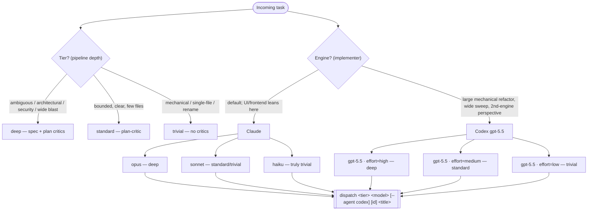

# Dispatch orchestration — the choosing tree

Canonical reference for how the dispatcher judges a task into **tier**, **engine**, and **model**. Keep it in sync with `DISPATCHER_PROTOCOL.md` (the baked rubric) and `dispatch.fish` (the mechanism).

## Three orthogonal levers

- **Tier = pipeline depth (who reviews).** Driven by risk/ambiguity/blast-radius, not size. A one-line security change is still `standard`/`deep`.
- **Engine = who implements.** Claude by default; codex `gpt-5.5` for large mechanical work, wide sweeps, or a deliberate second-engine perspective.
- **Model/effort = how strong / how hard it thinks.** Claude picks opus/sonnet/haiku by tier; codex is always `gpt-5.5` with reasoning effort scaled by tier (deep→high, standard→medium, trivial→low).

## MCP is no longer a routing factor

Both engines defer MCP tool schemas, so the base stack (context7, playwright, firefox-devtools) is ~free until a tool is used:

- **Claude** — deferred by default via tool-search (haiku is the one eager exception).
- **Codex** — schemas deferred (baked-in `always_defer_mcp_tools`; measured ~0 token cost), browsers launch lazily on first use, and the base stack is provisioned from the same `mcp-servers.nix` source via the nix-generated `--profile worker`.

The additive `--mcp analytics` (posthog, work) profile stays claude-only; `cad`/freecad was dropped.
