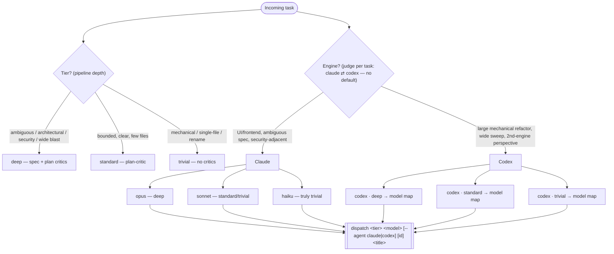

# Dispatch orchestration — the choosing tree

Canonical reference for how the dispatcher judges a task into **tier**, **engine**, and **model**. Keep it in sync with `DISPATCHER_PROTOCOL.md` (the baked rubric) and `dispatch.sh` (the mechanism).

## Model map (single source of truth)

The dispatcher picks the tier-appropriate model for the chosen engine from this
table. This is the ONLY place concrete model versions appear — prose elsewhere
says "the tier-appropriate model from the model map". Bump this one table when a
new model ships.

| Tier | claude ladder | codex ladder |
|---|---|---|
| `deep` | **opus** — escalate to **`claude-fable-5`** only for a genuinely hard, well-specified, long-horizon task where opus is demonstrably not enough (≈2× opus cost, refusal-classifier risk on security-adjacent code, minutes-long turns; most expensive lever, used rarely) | **`gpt-5.6`** |
| `standard` | **sonnet** | **`gpt-5.5`** |
| `trivial` | **sonnet** (or **haiku** if truly trivial) | current light gpt |

Codex reasoning effort still scales with tier automatically (deep→high,
standard→medium, trivial→low), independent of which gpt model is chosen.
`dispatch` does not validate the model slot — the map is enforced by the
dispatcher's judgment, not by code.

**Worker-session model vs execute-subagent model (claude).** The `<model>` in the map above is the **worker session** model — it does spec / plan / reconcile / judging (opus on deep). The worker's **execute subagents default to sonnet**, escalating a single step to opus only when the plan tags it `implement: opus`. So a deep claude worker is opus-orchestrated but sonnet-implemented by default. See `WORKER_PROTOCOL.md` rule 1 (and the fast deterministic gate + parallel review gate it now describes). Codex workers scale reasoning effort by tier instead — the split is claude-specific.

**Shape-tag vocabulary.** The outcome log's `shape` field is a closed set:
`mechanical`, `ui`, `ambiguous`, `security`, `wide`.

**Orchestration consult (worker-side, deep).** Decomposition help from Fable is decided **in the worker's worktree** at the plan seam, not by the dispatcher — the dispatcher's only lever is tiering the task `deep` (its existing "architectural / wide-blast" signal). See `WORKER_PROTOCOL.md` → "Orchestration consult". Every deep worker emits an outcome-metrics record to the bus at finish:
`crew msg worker:<branch> metrics:<crew_id> '{"consulted":…,"plan_critic_first_pass":…,"rework_count":…,"review_high":…}'`.
It rides `crew msg` (no `crew.sh` change) and never wakes the dispatcher. Consulted vs non-consulted deep workers are the A/B for whether the Fable lever pays — the counterfactual #86's oracle gate needs. Read it offline: `crew log <crew> | jq 'select(.to|startswith("metrics:"))'`.

## Three orthogonal levers

- **Tier = pipeline depth (who reviews).** Driven by risk/ambiguity/blast-radius, not size. A one-line security change is still `standard`/`deep`.
- **Engine = who implements.** Judged per task (claude ⇄ codex) — no default. Codex (work profile only) for large mechanical refactors, wide sweeps, or a deliberate second-engine perspective; claude for UI/frontend work, ambiguous specs, or security-adjacent code.
- **Model/effort = how strong / how hard it thinks.** Both engines pick the tier-appropriate model from the model map; codex reasoning effort scales with tier (deep→high, standard→medium, trivial→low) independent of which model is chosen.

## MCP is no longer a routing factor

Both engines defer MCP tool schemas, so the base stack (context7, playwright, firefox-devtools) is ~free until a tool is used:

- **Claude** — deferred by default via tool-search (haiku is the one eager exception).
- **Codex** — schemas deferred (baked-in `always_defer_mcp_tools`; measured ~0 token cost), browsers launch lazily on first use, and the base stack is provisioned from the same `mcp-servers.nix` source via the nix-generated `--profile worker`.

The additive `--mcp analytics` (posthog, work) profile stays claude-only; `cad`/freecad was dropped.
